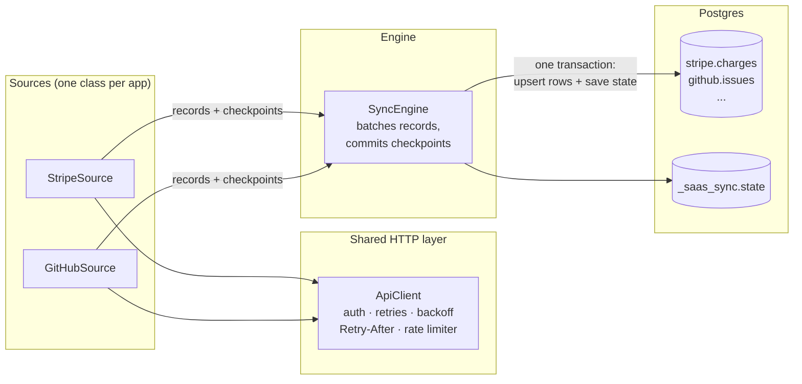

# saas-sync

A small ELT engine in Java: connectors that copy data out of SaaS APIs (**Stripe** and **GitHub**) into **Postgres**, and keep it up to date incrementally.

The first run copies everything. Every later run copies only what changed. Runs survive crashes, rate limits and schema changes without losing or duplicating data. Afterwards, data that was locked inside two apps can be queried with SQL:

```sql
-- Revenue per customer, from Stripe
SELECT c.email, SUM(ch.amount) / 100.0 AS total_paid
FROM stripe.charges ch
JOIN stripe.customers c ON c.id = ch.customer
WHERE ch.status = 'succeeded' AND NOT c._is_deleted
GROUP BY c.email ORDER BY total_paid DESC;

-- How long pull requests take to merge, from GitHub
SELECT percentile_cont(0.5) WITHIN GROUP (ORDER BY merged_at::timestamptz - created_at::timestamptz)
FROM github.pull_requests WHERE merged_at IS NOT NULL;
```

## Architecture



The split is the point of the design. Everything that differs between apps (authentication, pagination, how to detect changes) lives in a `Source`. Everything that is the same (scheduling, batching, retries, checkpoint storage, schema handling, writing) lives in the engine, the HTTP layer and the destination. **Adding a third app means implementing one interface:**

```java
public interface Source {
    String name();                       // "stripe" -> Postgres schema "stripe"
    List<StreamSpec> streams();          // "charges" -> table stripe.charges, keyed by "id"
    void read(StreamSpec stream, ObjectNode state, Emitter out) throws IOException, InterruptedException;
}
```

A source reads from its saved `state`, calls `out.emit(record)` for each record and `out.checkpoint(newState)` whenever it reaches a safe resume point. The engine handles the rest.

## Quickstart

Needs Java 21, Maven and Docker (`brew install openjdk@21 maven` on macOS).

```bash
docker compose up -d                       # Postgres 16 on localhost:5432, database "warehouse"
mvn -q package                             # builds target/saas-sync.jar
cp .env.example .env                       # then fill in your keys
set -a; source .env; set +a

java -jar target/saas-sync.jar sync stripe                     # all Stripe streams
java -jar target/saas-sync.jar sync github --streams issues    # one GitHub stream
java -jar target/saas-sync.jar state stripe                    # where each stream will resume
java -jar target/saas-sync.jar sync github --dry-run           # read the API, write nothing
```

The Stripe connector refuses live-mode keys unless `STRIPE_ALLOW_LIVE=true`. To get test data, create a few customers and payments in the dashboard's test mode, or use the Stripe CLI (`stripe trigger payment_intent.succeeded`, `stripe trigger customer.created`). Run `sync` again after changing something and only the change comes through.

A run prints a summary and exits non-zero if any stream failed, so it slots into cron or any scheduler:

```
stream                 status    records  deleted      time
stripe.charges         ok              3        0      0.6s
```

## How each connector finds changes

Each API offers different tools for "what changed since last time", so each stream uses the strategy its endpoint supports.

| Stream | First run | Later runs | Checkpoint |
|---|---|---|---|
| `stripe.*` (customers, charges, refunds, subscriptions) | List endpoint, cursor-paged with `starting_after` | **Events API** from the saved cursor, applied oldest-first | After every page, then the event cursor |
| `github.issues` | `since` + ascending sort by `updated_at` | Same, from the saved `since` | After every page |
| `github.pull_requests` | Descending by `updated_at`, `Link` header paging | Stop at the first PR older than the cursor; **ETag** on page one | End of run |
| `github.commits` | `since` on the commit date | Same, from the saved date | End of run |

**Why Stripe needs the Events API.** Stripe's list endpoints filter by creation time, not update time. A charge created last month and refunded today would never show up in a "created since" query. Every Stripe change emits an event carrying the full object after the change, so replaying events oldest-first leaves each row at its latest state. The full load records its start time first, and the event cursor starts there, so changes made *during* the full load are not missed.

**Why issues use keyset pagination instead of page numbers.** Issues are sorted by `updated_at` ascending. If an issue is updated while we're on page 3, it jumps to the end of the list. Every later issue shifts back one slot, and one issue gets skipped. So instead of asking for page 4, the connector asks for "updated since the last timestamp I saw". The one case keysets can't handle (more than 100 issues sharing one timestamp, e.g. after a bulk edit) falls back to page numbers for that stretch.

**Why pull requests checkpoint only at the end.** With newest-first order, a mid-run cursor would claim older PRs were done before they were read. Descending order with page numbers can show a PR twice but never skips one, and duplicates are harmless (see upserts below).

## Failure modes handled

| What goes wrong | What happens |
|---|---|
| Process crashes mid-sync | Records and the checkpoint covering them are committed **in one transaction**. The next run resumes from the last checkpoint; anything after it is read again. |
| The same record is read twice (crash replay, overlapping windows, PR shifted pages) | Rows are **upserted by primary key**, so replays never duplicate. |
| Same record twice in one batch | De-duplicated before insert, keeping the newest. (Postgres rejects an `ON CONFLICT` upsert that touches one key twice.) |
| `429 Too Many Requests` | Retried after the server's `Retry-After`. |
| GitHub `403` with `x-ratelimit-remaining: 0` | Waits until `x-ratelimit-reset`. If that's more than 15 minutes away, the stream stops cleanly and the next run continues from its checkpoint. |
| `5xx`, timeouts, connection resets | Exponential backoff with jitter, up to 6 attempts. |
| `400`, `401`, `404`, permission `403` | Not retried; the API's own error message is reported. |
| Hitting rate limits at all | A client-side token bucket keeps requests under each API's limit. |
| Stripe cursor older than the 30-day event retention | The gap can't be replayed, so the stream does a fresh full load instead of silently missing changes. |
| New field appears in the API | `ALTER TABLE ... ADD COLUMN` inside the same transaction. |
| A field changes type (`5` then `"five"`, a string then an array) | The column is **widened** (bigint → numeric → text; anything with JSON → jsonb) and existing values are converted. |
| Field names Postgres can't use (`+1`, `order-id`, 70-character paths) | Sanitized, truncated to 63 bytes with a hash suffix, collisions disambiguated. |
| `\u0000` in user-entered text | Stripped. Postgres rejects it in both `text` and `jsonb`, which would fail the whole batch. |
| A write fails halfway | Rows, `ALTER TABLE`s and state roll back together (Postgres DDL is transactional), and the column cache is invalidated. |
| One stream fails | Reported; the other streams still sync. |
| Stripe customer deleted | Row kept with `_is_deleted = true` and its last known values, so history and joins don't break. |
| Empty GitHub repository (`409`) | Treated as zero commits, not an error. |

## What the tables look like

Each stream becomes one table in a schema named after the source. Nested objects are flattened into `parent__child` columns up to three levels deep; deeper objects, arrays and free-form maps such as Stripe's `metadata` are stored as `jsonb`. Every table also has:

| Column | Meaning |
|---|---|
| `id` / `sha` | Primary key from the API, stored as text |
| `_raw_json` | The full record as received, for anything flattening didn't anticipate |
| `_is_deleted` | Set when the source reports a deletion |
| `_synced_at` | When this row was last written |

Sync state lives in `_saas_sync.state`, one row per stream:

```
 source |    stream     |                     state
--------+---------------+-----------------------------------------------
 stripe | charges       | {"phase": "incremental", "events_cursor": 1791802281}
 github | pull_requests | {"since": "2026-10-11T08:12:44Z", "etag": "W/\"9f2c...\""}
```

`saas-sync reset <source> [--streams ...]` clears it to force a full reload.

## Tests

```bash
mvn test                                                          # unit tests, mocked APIs
PG_TEST_URL=jdbc:postgresql://localhost:5432/warehouse mvn test   # plus Postgres and end-to-end tests
```

The connectors are tested against local HTTP servers that behave like Stripe and GitHub (cursor paging, `since` filtering, `Link` and `ETag` headers, rate-limit headers). The Postgres tests cover upserts, schema evolution, type widening, tombstones and transactional rollback, and an end-to-end test drives full load → incremental changes → idempotent replay against a real database. CI runs all of it against Postgres 16 on every push.

## Limitations and next steps

- **Stripe events are collected in memory** before being applied oldest-first. Fine for a gap of hours or days; a high-volume account syncing after a long pause should page the events window by time range instead.
- **GitHub deletions aren't detected.** The REST API has no change feed for deleted issues; a periodic full reconcile (compare IDs) would catch them.
- **Commits come from the default branch only**, filtered by commit date. A rebased commit with an old date can be missed; a fuller version would track branch heads and walk new commits.
- **Streams run one after another.** They're independent, so a thread pool per source would be an easy speed-up, as long as it shares one rate limiter.
- **Columns are never dropped or narrowed.** That's deliberate: downstream queries keep working when an API stops sending a field.

## Layout

```
src/main/java/io/github/saumyak0405/saassync/
  core/          Source, Destination, SyncEngine, Record, StreamSpec
  http/          ApiClient, RetryPolicy, RateLimiter, Authenticator
  schema/        Flattener, ColumnType (naming, flattening, type widening)
  destination/   PostgresDestination, InMemoryDestination
  sources/       stripe/StripeSource, github/GitHubSource
  cli/           Main
```
